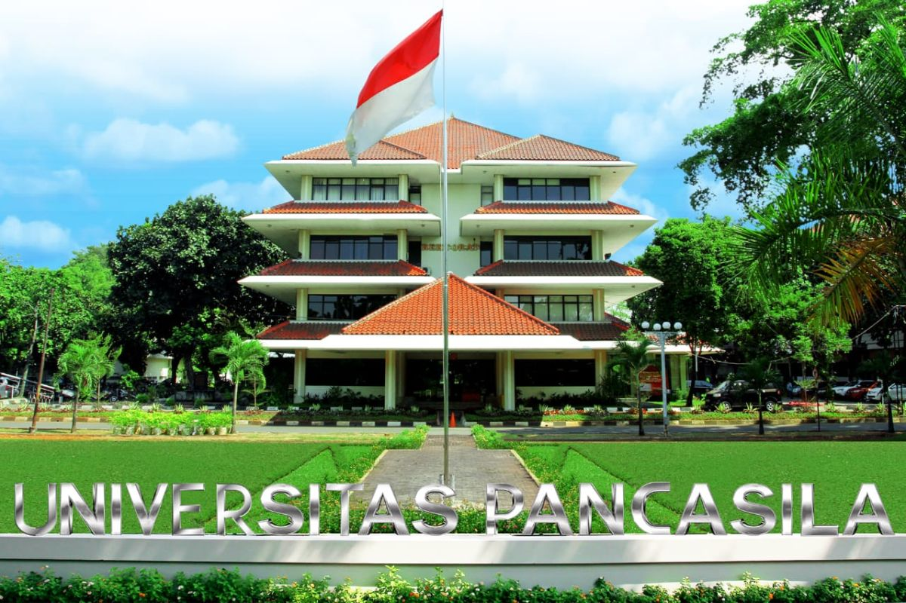
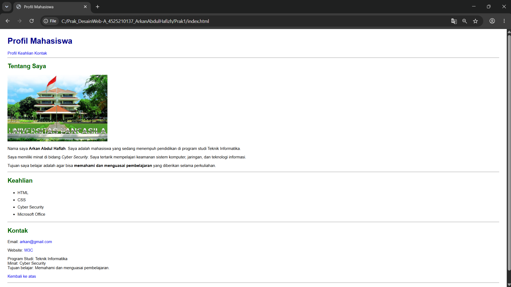

# Profil Mahasiswa



## Tentang Saya

Halo, nama saya **Arkan Abdul Hafizh**. Saya adalah mahasiswa program studi **Teknik Informatika** yang sedang mempelajari bidang teknologi informasi, khususnya *HTML, CSS,* dan *Cyber Security*.

## Pendidikan

Saya sedang menempuh pendidikan di program studi Teknik Informatika. Dalam proses pembelajaran, saya mempelajari dasar-dasar pemrograman dan pembuatan website.

### Minat

Saya memiliki minat pada:

- Cyber Security
- Keamanan sistem komputer dan jaringan
- Pengembangan website
- Teknologi informasi

### Tujuan Belajar

Tujuan saya belajar adalah agar dapat memahami dan menguasai pembelajaran yang diberikan selama perkuliahan, serta meningkatkan kemampuan coding untuk membuat proyek yang bermanfaat.

## Keahlian

- HTML
- CSS
- Cyber Security
- Microsoft Office

## Isi Halaman

Halaman `index.html` terdiri dari beberapa bagian:

| Bagian | Isi |
|---|---|
| Beranda | Judul halaman dan menu navigasi |
| Profil | Foto, deskripsi diri, minat, dan tujuan belajar |
| Keahlian | Daftar keahlian dalam bentuk list |
| Kontak | Email, tautan website, dan informasi program studi |
| Footer | Hak cipta |

## Struktur Project

```text
project/
│
├── css/
│   └── style.css
├── images/
│   ├── hasil.png
│   └── profil.jpg
├── index.html
└── README.md
```

## Hasil Tampilan



## Cara Menjalankan

1. Buka folder project di VS Code atau file explorer.
2. Buka file `index.html` dengan browser (klik dua kali atau gunakan ekstensi *Live Server*).
3. Pastikan folder `css` dan `images` berada satu level dengan `index.html`.

## Kontak

- **Email:** [arkan@gmail.com](mailto:arkan@gmail.com)
- **Website referensi:** [W3C](https://www.w3.org/)

&copy; 2026 Arkan Abdul Hafizh.