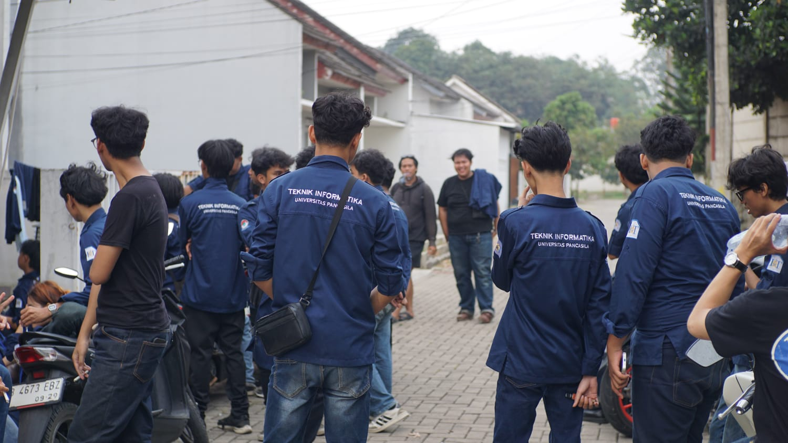

# Laporan Praktikum Web Profil IMATIKA Universitas Pancasila


## Nama :

* **Nama:** Arkan Abdul Hafizh
* **Program Studi:** Teknik Informatika
* **NPM:** 4525210137

---

## Ringkasan

Halaman profil **IMATIKA Universitas Pancasila** dibangun dengan HTML murni, terdiri dari navigasi internal, identitas organisasi, daftar divisi, alur *open recruitment*, dan kontak.

Tiga jenis *list* digunakan sesuai konteks: `<dl>` untuk data identitas, `<ul>` untuk daftar divisi, dan `<ol>` untuk tahapan oprec. Navigasi antar-bagian memakai *anchor* internal (`id`), dilengkapi tautan eksternal dan *mailto*. Atribut `alt` ditambahkan pada semua gambar untuk menjaga aksesibilitas.

---

## Struktur Folder

```
Prak1/
├── dokumentasi/
│   ├── HASIL 1.png
│   └── HASIL 2.png
├── images/
│   ├── kegiatan-imatika.jpeg
│   └── logo-imatika.jpeg
├── prak1.html
└── README.md
```

---

## Tentang IMATIKA

**IMATIKA** (Ikatan Mahasiswa Teknik Informatika) Universitas Pancasila adalah organisasi mahasiswa yang menjadi wadah pengembangan diri, kolaborasi, dan kegiatan akademik maupun non-akademik bagi mahasiswa Teknik Informatika.

### Logo IMATIKA


### Kegiatan IMATIKA



*Dokumentasi kegiatan rapat dan kebersamaan anggota IMATIKA.*

---

## Fitur Halaman

| Elemen HTML | Penggunaan |
|---|---|
| `<dl>`, `<dt>`, `<dd>` | Data identitas organisasi |
| `<ul>`, `<li>` | Daftar divisi |
| `<ol>`, `<li>` | Tahapan *open recruitment* |
| `<a href="#id">` | Navigasi internal antar-bagian |
| `<a href="https://...">` | Tautan eksternal |
| `<a href="mailto:...">` | Tautan email |
| `` | Gambar dengan teks alternatif |

---

## Hasil Tampilan

### Hasil 1


### Hasil 2


---

## Cara Menjalankan

1. Buka folder `Prak1` di VS Code atau file explorer.
2. Buka file `prak1.html` dengan browser (klik dua kali atau gunakan ekstensi *Live Server*).
3. Pastikan folder `images` tetap berada satu level dengan `prak1.html` agar gambar tampil.

---

## Tautan Terkait

* **Situs Kampus:** [Universitas Pancasila](https://univpancasila.ac.id)
* **Instagram Organisasi:** [@imatika_ftkmup](https://instagram.com/imatika_ftkmup)
* **Email Resmi:** imatika@univpancasila.ac.id