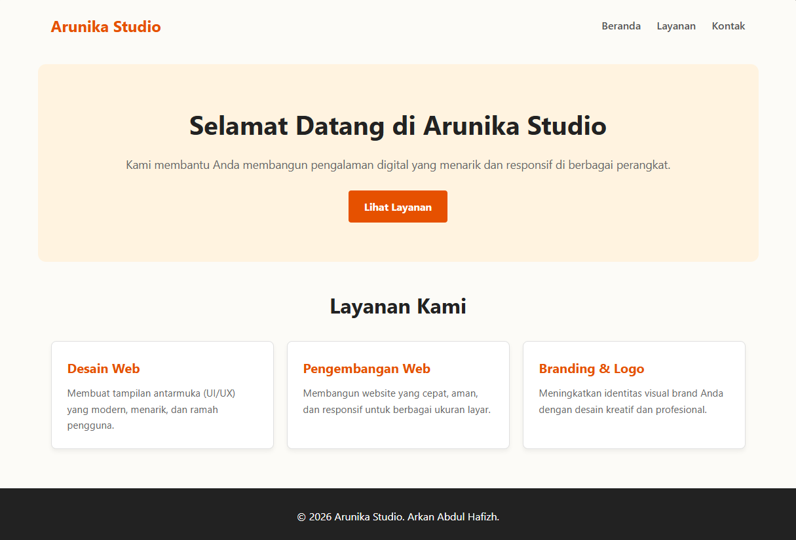
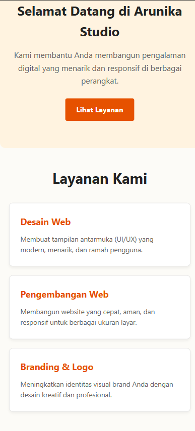

# Landing Page - Arunika Studio

Proyek ini merupakan penugasan individu praktikum web untuk membangun ulang halaman profil menjadi *landing page* responsif berbasis HTML5 dan CSS3 untuk **Arunika Studio**.

---

### 👤 Identitas Mahasiswa
- **Nama:** Arkan Abdul Hafizh
- **NPM:** 4525210137

---

## 📌 Deskripsi Proyek

Arunika Studio membutuhkan halaman *landing page* yang responsif dan nyaman diakses baik melalui perangkat desktop maupun ponsel. Proyek ini memisahkan kode struktur HTML dan tata letak CSS secara bersih, menerapkan konsep *box model*, memanfaatkan *reusable class*, serta mengimplementasikan *media query* untuk penyesuaian layar mobile.

---

## 📸 Before & After

### Before (Sebelum Perubahan)
Tampilan pada layar mobile ketika belum diterapkan media query (layout 3 card dipaksa horizontal sehingga berantakan):



---

### After (Sesudah Perubahan)
Tampilan responsif pada layar mobile di bawah 768px (layout 3 card otomatis berubah menjadi 1 kolom vertikal):



---

## 🌟 Fitur & Elemen Utama
- **Header & Navigasi:** Menampilkan nama studio dan tautan menu navigasi yang rapi.
- **Hero Section:** Area utama yang berisi judul pembuka, deskripsi singkat, dan tombol *Call to Action* (CTA).
- **Services Section:** Menampilkan 3 kartu layanan utama studio yang responsif.
- **Footer:** Bagian penutup yang memuat hak cipta dan informasi hak cipta studio.

---

## 🛠️ Aturan Teknis Praktikum

1. **Pemisahan Kode Eksternal:** Seluruh atribut gaya dipisahkan sepenuhnya ke dalam file `style.css` tanpa ada atribut inline/internal style di `index.html`.
2. **Penerapan Box Model:** Menggunakan `box-sizing: border-box` serta pengaturan `padding`, `margin`, dan `border` yang presisi pada setiap komponen kartu.
3. **Reusable Classes (Minimal 2):**
   - `.container`: Mengatur batas lebar maksimal dan posisi konten agar tetap presisi di tengah.
   - `.card-custom`: Menyediakan styling dasar yang seragam untuk setiap kartu layanan.
4. **Media Query (< 768px):** Mengubah grid 3 kolom pada `.card-grid` menjadi **1 kolom tumpuk vertikal** saat diakses via ponsel.

---

## 📂 Struktur Folder Proyek

```text
.
├── images/
│   ├── AfterHasilMobile.png
│   └── BeforeDesktop.png
├── index.html
├── README.md
└── style.css