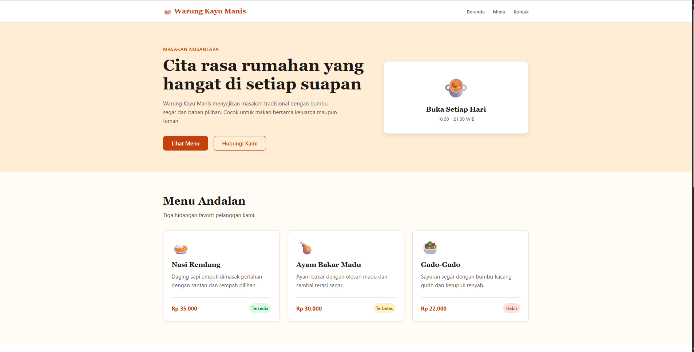
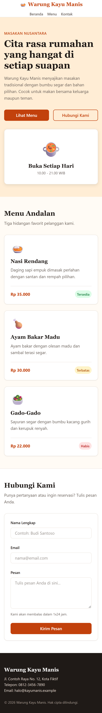
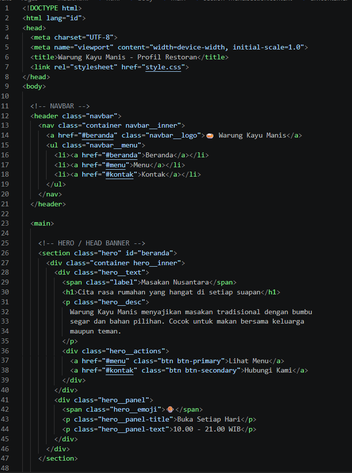
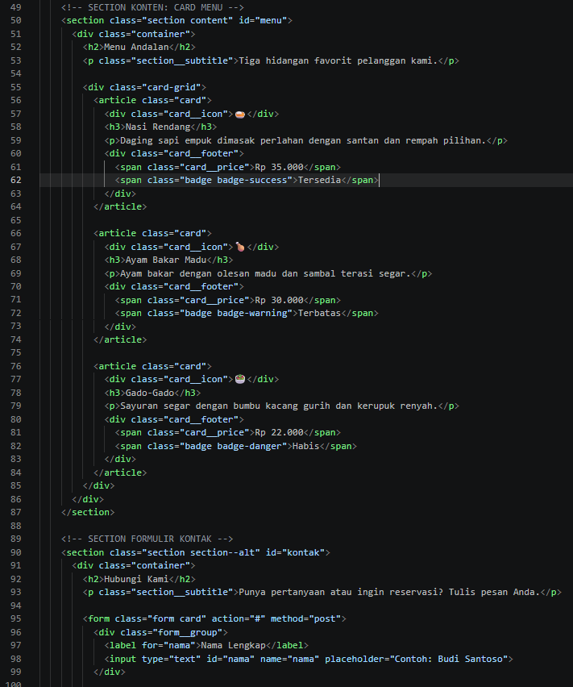
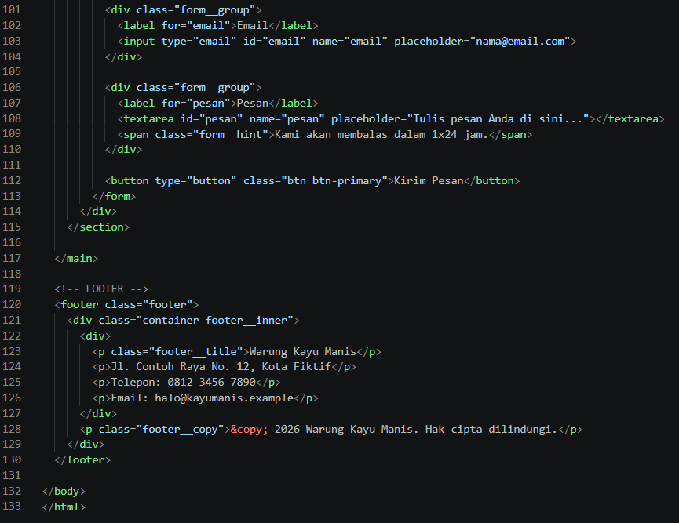

# Tugas Praktikum Pertemuan 6: Mockup Halaman Web

**Visual Hierarchy, Warna, dan Tipografi**

| | |
|---|---|
| Nama | Arkan Abdul Hafizh |
| NIM | 4525210137 |
| Mata Kuliah | Praktikum Desain Web (Kelas A) |
| Tema | Profil Restoran "Warung Kayu Manis" (fiktif) |

---

## 1. Deskripsi Tugas

Membuat **Simple Design System** yang berisi colors, typography, spacing, buttons, form controls, dan cards. Design system tersebut diterapkan untuk mengembangkan mockup Contoh 2 (Pertemuan 6) berupa halaman profil restoran, lengkap dengan Color Palette, Type Scale, Button Style, Card Style, dan satu tampilan versi mobile.

Ketentuan: hanya menggunakan **HTML5 dan CSS3 murni** (tanpa JavaScript maupun framework).

## 2. Struktur Folder

```
Tugas/
├── images/
│   ├── Hasil.png
│   ├── HasilMobile.png
│   ├── Index1.png
│   ├── Index2.png
│   └── Index3.png
├── index.html
└── style.css
```

## 3. Cara Menjalankan

1. Download atau clone folder project ini.
2. Buka file `index.html` dengan browser (Chrome, Edge, atau Firefox).
3. Untuk melihat versi mobile, tekan **F12**, lalu **Ctrl+Shift+M** dan pilih ukuran perangkat.

---

## 4. Hasil Tampilan

### Tampilan Desktop



Tampilan desktop terdiri dari navbar (logo di kiri, menu di kanan), hero section dua kolom, tiga card menu sejajar, formulir kontak, dan footer.

### Tampilan Mobile



Pada layar kecil (maksimal 768px), navbar ditumpuk vertikal, hero berubah menjadi satu kolom, card menjadi satu kolom, dan tombol formulir memenuhi lebar layar.

---

## 5. Source Code

### index.html

Kode `index.html` ditampilkan dalam tiga bagian berurutan.

**Bagian 1**



**Bagian 2 (lanjutan)**



**Bagian 3 (lanjutan)**



### style.css

Seluruh gaya ada di file `style.css`, yang diawali blok `:root` berisi design tokens (warna, font, spacing, radius, shadow).

---

## 6. Simple Design System

### a. Color Palette

| Kategori | Token | Kode | Kegunaan |
|---|---|---|---|
| Primary | `--primary` | `#C2410C` | Tombol utama, logo, harga |
| Primary | `--primary-dark` | `#9A3412` | Hover tombol primary |
| Primary | `--primary-light` | `#FFEDD5` | Latar hero, hover tombol secondary |
| Accent | `--accent` | `#F59E0B` | Warna pendukung |
| Neutral | `--bg` | `#FFFBF5` | Latar halaman |
| Neutral | `--white` | `#FFFFFF` | Latar card, navbar, input |
| Neutral | `--text` | `#1F1A17` | Teks utama, latar footer |
| Neutral | `--muted` | `#6B625B` | Teks pendukung |
| Neutral | `--border` | `#E7DED5` | Garis pembatas |
| Success | `--success` | `#15803D` | Badge "Tersedia" |
| Warning | `--warning` | `#B45309` | Badge "Terbatas" |
| Danger | `--danger` | `#B91C1C` | Badge "Habis" |

### b. Typography (maksimal 2 font)

- **Heading:** Georgia (serif)
- **Body:** font sans-serif bawaan sistem (`system-ui`)

| Level | Ukuran | Weight | Line-height | Dipakai untuk |
|---|---|---|---|---|
| H1 | 48px (mobile 36px) | Bold | 1.15 | Judul hero |
| H2 | 32px (mobile 26px) | Bold | 1.25 | Judul section |
| H3 | 20px | Bold | 1.3 | Judul card, logo |
| Body | 16px | Regular | 1.6 | Paragraf |
| Label | 14px | Semibold | 1.6 | Label form, menu navbar |
| Caption | 13px | Semibold | 1.6 | Badge, hint, hak cipta |

### c. Spacing System

| Token | Nilai | Contoh penggunaan |
|---|---|---|
| `--s1` | 4px | Jarak hint, padding badge |
| `--s2` | 8px | Jarak label ke input, padding tombol |
| `--s3` | 16px | Padding input, jarak antar tombol |
| `--s4` | 24px | Padding card, jarak antar card |
| `--s5` | 32px | Padding form |
| `--s6` | 48px | Jarak antar blok besar |
| `--s7` | 64px | Padding atas-bawah section |

### d. Button Styles

| Jenis | Tampilan | Hover |
|---|---|---|
| Primary | Latar oranye bata, teks putih | Latar lebih gelap + shadow |
| Secondary | Transparan, border dan teks oranye | Latar oranye muda |

Keduanya memakai padding `8px 24px`, border-radius `8px`, font 16px semibold, dan transisi 0.2 detik.

### e. Form Controls

Input teks, input email, dan textarea memiliki gaya seragam: padding `8px 16px`, border 1px, radius 8px, label di atas field (14px semibold). Saat fokus, border berubah menjadi warna primary dengan ring oranye muda. Form hanya berupa tampilan visual tanpa fungsi pengiriman data.

### f. Card Styles

Semua card memakai latar putih, border 1px, radius 12px, padding 24px, dan shadow ringan. Saat di-hover, card naik sedikit dengan shadow lebih tegas. Struktur isi seragam: ikon, judul, deskripsi, lalu footer berisi harga dan badge status.

---

## 7. Penjelasan Bagian Kode

| Bagian | Fungsi |
|---|---|
| `:root` | Menyimpan semua token (warna, font, spacing) di satu tempat |
| `.navbar` | Logo kiri dan menu kanan dengan `display: flex` dan `justify-content: space-between` |
| `.hero` | Head banner dua kolom dengan CSS Grid (teks dan panel jam buka) |
| `.card-grid` | Tiga card sejajar di desktop |
| `.badge-*` | Penerapan warna status success, warning, danger |
| `.form` | Formulir kontak (nama, email, pesan, tombol kirim) |
| `.footer` | Informasi kontak dan hak cipta |
| `@media (max-width: 768px)` | Mengubah layout menjadi satu kolom pada layar HP |

---

## 8. Perubahan Desain, Masalah, dan Solusi

### Perubahan (Sebelum dan Sesudah)

| Aspek | Sebelum (tanpa design system) | Sesudah |
|---|---|---|
| Warna | Hitam-putih bawaan browser | Palette primary, accent, neutral, dan status |
| Tipografi | Ukuran tidak terkontrol | Type scale konsisten dengan 2 font |
| Jarak | Rapat dan tidak teratur | Kelipatan 4/8 px |
| Tombol dan form | Tampilan default browser | Gaya seragam dengan efek hover dan fokus |
| Layout | Elemen menumpuk vertikal | Navbar, hero 2 kolom, grid 3 card |
| Mobile | Tidak disesuaikan | Satu kolom, tombol penuh |

### Masalah dan Solusi

| Masalah | Penyebab | Solusi |
|---|---|---|
| CSS tidak terbaca | Path atau nama file salah | Pastikan `style.css` satu folder dengan `index.html` |
| Tampilan HP sama seperti desktop | Tag viewport belum ada | Tambahkan `<meta name="viewport" ...>` di `<head>` |
| Lebar input melebihi card | Padding menambah lebar elemen | Gunakan `box-sizing: border-box` |
| Navbar sempit di HP | Logo dan menu satu baris | Ubah `flex-direction` menjadi `column` pada media query |
| Teks sulit dibaca di latar muda | Kontras rendah | Gunakan teks gelap atau warna status versi tua |
| Extension Mobile Preview error | Gagal menulis ke user settings VS Code | Memakai mode device bawaan browser (F12, lalu Ctrl+Shift+M) |

---

## 9. Kesimpulan

Dengan Simple Design System, tampilan website menjadi lebih konsisten, rapi, dan mudah dikembangkan. Mengubah tema cukup dilakukan di blok `:root`, tanpa mengedit satu per satu komponen.