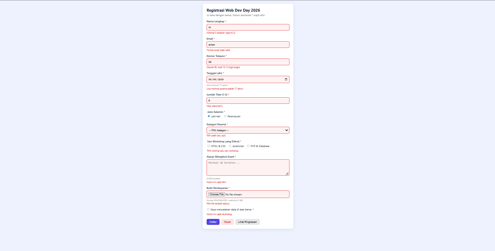
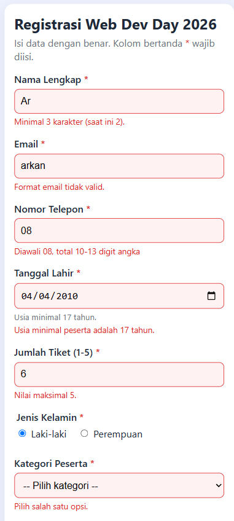
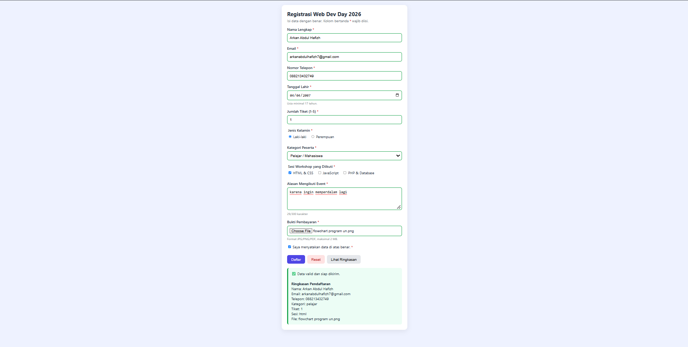

# Form Registrasi Event: Web Dev Day 2026

**Tugas Praktikum Pertemuan 7: HTML Form Dasar (Input dan Pengiriman Data)**

| | |
|---|---|
| Nama | Arkan Abdul Hafizh |
| NPM | 4525210137 |

## 1. Deskripsi

Form registrasi peserta event "Web Dev Day 2026" yang dibuat dengan HTML, CSS, dan JavaScript. Form memuat kontrol radio, checkbox, select, textarea, dan upload file, dilengkapi 8 aturan validasi. Saat ada isian yang salah, seluruh pesan error ditampilkan sekaligus di bawah masing-masing field.

## 2. Struktur Folder

```
.
├── README.md
├── images/
│   ├── desktop-eror.png
│   ├── mobile-eror.png
│   └── desktop-berhasil.png
└── registrasi-event/
    ├── index.html
    ├── style.css
    └── script.js
```

## 3. Kebutuhan Tugas dan Implementasinya

| Kebutuhan Tugas | Implementasi |
|-----------------|--------------|
| Radio | Jenis Kelamin (`name="jenis_kelamin"`) |
| Checkbox | Sesi Workshop (`name="sesi[]"`) dan persetujuan data |
| Select | Kategori Peserta |
| Textarea | Alasan Mengikuti Event |
| Upload | Bukti Pembayaran (`type="file"`) |
| Minimal 4 aturan validasi | 8 aturan (bagian 5) |
| Uji minimal 5 skenario input salah | 10 skenario salah + 1 skenario benar (bagian 6) |
| Test case validasi | Tabel di bagian 6 |
| Validasi yang wajib di server | Bagian 7 |

## 4. Fitur Form

**Elemen form (sesuai materi)**
- `<form>` dengan `action="proses.php"`, `method="post"`, dan `enctype="multipart/form-data"` (wajib agar file upload terkirim).
- Atribut `name` pada setiap kontrol sebagai key data yang dikirim.
- `<label for="...">` terhubung dengan `id` input untuk aksesibilitas dan memperluas area klik.
- `<fieldset>` dan `<legend>` untuk mengelompokkan radio dan checkbox.

**Tipe input:** `text`, `email`, `tel`, `date`, `number`, `radio`, `checkbox`, `file`, `<select>`, `<textarea>`.

**Jenis tombol**
- `type="submit"`: tombol **Daftar**, memicu pengiriman dan validasi.
- `type="reset"`: tombol **Reset**, dilengkapi `confirm()` agar isian tidak terhapus tidak sengaja.
- `type="button"`: tombol **Lihat Ringkasan**, dikendalikan lewat JavaScript.

**Fitur tambahan:** semua pesan error tampil sekaligus, field salah ditandai merah, pesan hilang otomatis saat diperbaiki, penghitung karakter textarea, dan tampilan responsif untuk mobile.

## 5. Aturan Validasi

| No | Aturan | Field | Cara |
|----|--------|-------|------|
| 1 | Wajib diisi | Semua field bertanda * | `required` |
| 2 | Format email | Email | `type="email"` |
| 3 | Pola karakter | Nama (huruf saja), Telepon (08 + 10-13 digit) | `pattern` |
| 4 | Panjang min/max | Nama (3-50), Alasan (20-300) | `minlength`, `maxlength` |
| 5 | Rentang angka | Jumlah tiket 1-5 | `min`, `max` |
| 6 | Usia minimal 17 tahun | Tanggal lahir | JS `max` + `setCustomValidity` |
| 7 | Minimal 1 checkbox dipilih | Sesi workshop | JS `setCustomValidity` |
| 8 | Tipe dan ukuran file | Bukti pembayaran (JPG/PNG/PDF, maks 2 MB) | JS cek ekstensi dan `file.size` |

## 6. Pengujian dan Test Case Validasi

### 6.1 Test Case

| No | Field | Input Uji | Hasil yang Diharapkan | Hasil Aktual |
|----|-------|-----------|-----------------------|--------------|
| 1 | Nama Lengkap | `Ar` | Ditolak karena kurang dari 3 karakter | Sesuai. Muncul pesan "Minimal 3 karakter (saat ini 2)." dan field berwarna merah |
| 2 | Email | `arkan` | Ditolak karena format email tidak valid | Sesuai. Muncul pesan "Format email tidak valid." |
| 3 | Nomor Telepon | `08` | Ditolak karena tidak sesuai pola 10-13 digit | Sesuai. Muncul pesan "Diawali 08, total 10-13 digit angka" |
| 4 | Tanggal Lahir | `04/04/2010` | Ditolak karena usia di bawah 17 tahun | Sesuai. Muncul pesan "Usia minimal peserta adalah 17 tahun." |
| 5 | Jumlah Tiket | `6` | Ditolak karena melebihi maksimum 5 | Sesuai. Muncul pesan "Nilai maksimal 5." |
| 6 | Kategori Peserta | Belum dipilih | Ditolak karena wajib memilih | Sesuai. Muncul pesan "Pilih salah satu opsi." |
| 7 | Sesi Workshop | Tidak ada yang dicentang | Ditolak karena minimal 1 sesi | Sesuai. Muncul pesan "Pilih minimal satu sesi workshop." |
| 8 | Alasan Mengikuti Event | Kosong | Ditolak karena wajib diisi | Sesuai. Muncul pesan "Kolom ini wajib diisi." |
| 9 | Bukti Pembayaran | Belum memilih file | Ditolak karena file wajib diunggah | Sesuai. Muncul pesan "Pilih file terlebih dahulu." |
| 10 | Persetujuan | Tidak dicentang | Ditolak karena wajib dicentang | Sesuai. Muncul pesan "Kolom ini wajib dicentang." |
| 11 | Semua field | Nama `Arkan Abdul Hafizh`, email valid, telepon `088213432749`, tanggal lahir `04/04/2007`, tiket `1`, kategori Pelajar/Mahasiswa, sesi HTML & CSS, alasan 29 karakter, file `.png`, persetujuan dicentang | Lolos validasi dan muncul kotak hijau | Sesuai. Semua field berborder hijau dan muncul kotak hijau "Data valid dan siap dikirim" beserta ringkasan pendaftaran |

Semua skenario berjalan sesuai harapan. Pada skenario input salah, seluruh pesan error tampil bersamaan dalam satu halaman.

### 6.2 Screenshot Desktop: Input Salah



### 6.3 Screenshot Mobile: Input Salah



### 6.4 Screenshot Desktop: Input Benar (Berhasil)



## 7. Validasi yang Tetap Wajib di Server

Validasi di browser hanya untuk kenyamanan pengguna dan bisa dilewati lewat DevTools (menghapus atribut `required`), Postman, atau `curl`. Hal berikut tetap harus dicek di server:

1. **Semua validasi diulang**: required, panjang, pola nama/telepon, rentang tiket, dan format email. Data dari klien tidak boleh dipercaya.
2. **Tipe file sebenarnya**: ekstensi dan atribut `accept` mudah dipalsukan. Server harus memeriksa MIME type dan isi file (mis. `finfo_file()` di PHP), membatasi ukuran, mengganti nama file dengan nama acak, dan menyimpannya di folder yang tidak bisa mengeksekusi script.
3. **Nilai radio dan select**: pastikan hanya nilai yang diizinkan (`L`/`P`; `pelajar`/`profesional`/`umum`) karena nilai bisa diubah manual.
4. **Usia**: hitung ulang dari tanggal lahir di server, bukan mengandalkan atribut `max` di HTML.
5. **Keamanan data**: sanitasi dan escape output (anti-XSS), prepared statement (anti-SQL injection), dan token CSRF.
6. **Aturan bisnis**: email sudah terdaftar atau belum, kuota tiket tersisa, dan batas waktu pendaftaran. Hanya server yang bisa mengetahuinya.
7. **HTTPS**: sesuai catatan materi, `method="post"` saja tidak menjamin keamanan tanpa HTTPS dan validasi server.

## 8. Penjelasan Perubahan, Masalah, dan Solusi

| Masalah | Penyebab | Solusi |
|---------|----------|--------|
| File upload tidak terkirim | Form belum memakai `enctype` yang sesuai | Tambah `enctype="multipart/form-data"` pada `<form>` |
| Checkbox group tidak bisa memakai `required` | `required` berlaku per checkbox, jadi semua harus dicentang | Pakai JS `setCustomValidity` untuk memeriksa minimal satu dicentang |
| Pesan `pattern` tidak jelas | Pesan bawaan browser bersifat generik | Tambah atribut `title` sebagai petunjuk format |
| Validasi file tidak ada di HTML | `accept` hanya filter dialog, bukan validasi | Cek ekstensi dan `file.size` di JavaScript |
| Tombol Reset berbahaya | Bisa menghapus semua isian tanpa sengaja | Tambah `confirm()` sebelum reset |
| Kolom merah muncul sebelum diisi | Selector `:invalid` aktif sejak halaman dibuka | Pakai `:user-invalid` agar aktif setelah pengguna berinteraksi |
| Hanya 1 pesan error yang tampil | Browser hanya menampilkan tooltip untuk field invalid pertama | Tambah `novalidate`, lalu tampilkan semua pesan lewat JS memakai `validity` dan `validationMessage` |
| Pesan error browser berbahasa Inggris | Pesan bawaan mengikuti bahasa browser | Pesan diterjemahkan lewat fungsi `terjemah()` ke bahasa Indonesia |
| Pengujian tanpa backend | `proses.php` belum dibuat | `preventDefault()` pada submit sebagai demo; aktifkan `form.submit()` jika backend siap |
| Risiko XSS di ringkasan | Input pengguna dimasukkan ke `innerHTML` | Fungsi `esc()` untuk meng-escape karakter HTML |

## 9. Cara Menjalankan

1. Buka folder `registrasi-event/`.
2. Buka `index.html` di browser (Chrome/Edge/Firefox).
3. Untuk tampilan mobile: tekan F12, klik ikon device toolbar, pilih perangkat.
4. Isi form dengan data salah sesuai tabel test case, lalu klik **Daftar**.

## 10. Bukti yang Dikumpulkan

- [x] Source code (`registrasi-event/index.html`, `style.css`, `script.js`)
- [x] Screenshot desktop dan mobile untuk skenario input salah (`images/`)
- [x] Screenshot desktop untuk skenario berhasil (`images/desktop-berhasil.png`)
- [x] Penjelasan perubahan, masalah, dan solusi (bagian 8)