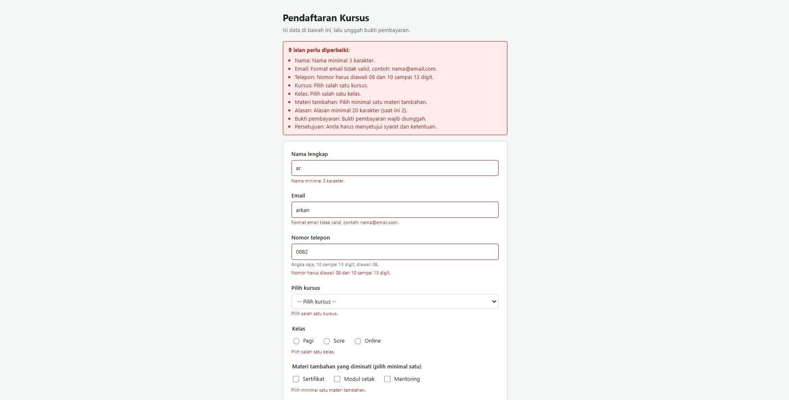
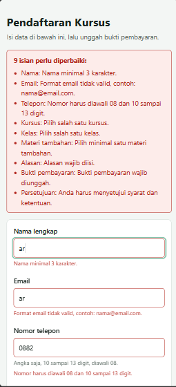

# Form Pendaftaran Kursus

**Tugas Praktikum: HTML Form Lanjutan (Pilihan, Upload, Textarea, dan Validasi HTML)**

| | |
|---|---|
| Nama | Arkan Abdul Hafizh |
| NPM | 4525210137 |

## 1. Deskripsi

Form pendaftaran kursus yang dibuat dengan HTML, CSS, dan JavaScript. Form memuat kontrol radio, checkbox, select, textarea, dan upload bukti pembayaran, dilengkapi 3 jenis button dan 9 aturan validasi. Saat ada isian yang salah, seluruh pesan error ditampilkan sekaligus: di ringkasan atas form dan di bawah masing-masing field.

## 2. Struktur Folder

```
Prak8/
├── README.md
├── index.html
├── script.js
├── css/
│   └── style.css
└── images/
    ├── desktop.png
    └── mobile.png
```

## 3. Kebutuhan Tugas dan Implementasinya

| Kebutuhan Tugas | Implementasi |
|-----------------|--------------|
| Radio | Pilihan Kelas: Pagi, Sore, Online (`name="kelas"`) |
| Checkbox | Materi tambahan (`name="materi"`) dan persetujuan syarat (`id="setuju"`) |
| Select | Pilih kursus (`name="kursus"`) |
| Textarea | Alasan mengikuti kursus (`name="alasan"`, maksimal 300 karakter) |
| Upload | Bukti pembayaran (`type="file"`, `accept=".jpg,.jpeg,.png,.pdf"`) |
| 3 jenis button | `submit`, `button`, dan `reset` |
| Minimal 4 aturan validasi | 9 aturan (bagian 5) |
| Uji minimal 5 skenario input salah | 8 skenario (bagian 6) |
| Test case validasi (field, input uji, hasil diharapkan, hasil aktual) | Tabel di bagian 6 |
| Validasi yang wajib di server | Bagian 7 |

## 4. Fitur Form

**Elemen form**
- `<label for="...">` terhubung dengan `id` input agar area klik lebih luas dan lebih mudah diakses.
- `<fieldset>` dan `<legend>` untuk mengelompokkan radio dan checkbox.
- Atribut `name` pada setiap kontrol sebagai key data yang dikirim.
- `placeholder` dan teks petunjuk (`hint`) untuk format telepon dan file.
- Atribut `novalidate` pada `<form>` agar seluruh pesan error bisa ditampilkan lewat JavaScript, bukan hanya tooltip bawaan browser.

**Tipe input:** `text`, `email`, `tel`, `radio`, `checkbox`, `file`, `<select>`, `<textarea>`.

**Jenis button**
- `type="submit"`: tombol **Daftar sekarang**, menjalankan validasi seluruh field.
- `type="button"`: tombol **Pratinjau data**, menampilkan ringkasan isian lewat JavaScript.
- `type="reset"`: tombol **Kosongkan form**, mengembalikan semua isian dan menghapus pesan error.

**Fitur tambahan:** field salah ditandai merah, pesan error hilang saat field diperbaiki (validasi saat pindah kolom), penghitung karakter textarea, ringkasan jumlah kesalahan di atas form, dan tampilan responsif untuk mobile.

## 5. Aturan Validasi

| No | Aturan | Field | Cara |
|----|--------|-------|------|
| 1 | Wajib diisi | Nama, email, telepon, kursus, kelas, alasan, bukti, persetujuan | JavaScript |
| 2 | Pola karakter nama: huruf dan spasi saja, minimal 3 karakter | Nama | Regex |
| 3 | Format email valid | Email | Regex |
| 4 | Telepon hanya angka, diawali 08, total 10 sampai 13 digit | Telepon | Regex |
| 5 | Pilihan wajib dipilih | Kursus (select), kelas (radio) | JavaScript |
| 6 | Minimal 1 checkbox dipilih | Materi tambahan | JavaScript |
| 7 | Panjang minimal 20 karakter, maksimal 300 | Alasan (textarea) | JavaScript dan `maxlength` |
| 8 | Tipe dan ukuran file: JPG/PNG/PDF, maksimal 2 MB | Bukti pembayaran | JavaScript (cek ekstensi dan `file.size`) |
| 9 | Persetujuan harus dicentang | Syarat dan ketentuan | JavaScript |

## 6. Pengujian dan Test Case Validasi

### 6.1 Test Case

| No | Field | Input Uji | Hasil yang Diharapkan | Hasil Aktual |
|----|-------|-----------|-----------------------|--------------|
| 1 | Nama lengkap | `12345` | Ditolak karena bukan huruf | Muncul pesan "Nama hanya boleh berisi huruf dan spasi." dan field berwarna merah |
| 2 | Email | `budi@` | Ditolak karena format email tidak valid | Muncul pesan "Format email tidak valid, contoh: nama@email.com." |
| 3 | Nomor telepon | `0812abc` | Ditolak karena mengandung huruf | Muncul pesan "Nomor telepon hanya boleh berisi angka." |
| 4 | Nomor telepon | `08123` | Ditolak karena kurang dari 10 digit | Muncul pesan "Nomor harus diawali 08 dan 10 sampai 13 digit." |
| 5 | Alasan (textarea) | `Ingin belajar` (13 karakter) | Ditolak karena kurang dari 20 karakter | Muncul pesan "Alasan minimal 20 karakter (saat ini 13)." |
| 6 | Bukti pembayaran | File `bukti.exe` atau file lebih dari 2 MB | Ditolak karena format atau ukuran tidak sesuai | Muncul pesan "Format file harus JPG, PNG, atau PDF." atau "Ukuran file maksimal 2 MB." |
| 7 | Kursus, kelas, materi | Tidak dipilih | Ditolak karena wajib dipilih | Muncul pesan "Pilih salah satu kursus.", "Pilih salah satu kelas.", dan "Pilih minimal satu materi tambahan." |
| 8 | Persetujuan | Tidak dicentang | Ditolak karena wajib dicentang | Muncul pesan "Anda harus menyetujui syarat dan ketentuan." |

Pada skenario input salah, seluruh pesan error tampil bersamaan, ditambah ringkasan "isian perlu diperbaiki" di atas form.

### 6.2 Screenshot Desktop: Input Salah



### 6.3 Screenshot Mobile: Input Salah



## 7. Validasi yang Tetap Wajib di Server

Validasi di browser hanya untuk kenyamanan pengguna dan bisa dilewati lewat DevTools (mengubah atau menghapus kode), Postman, atau `curl`. Hal berikut tetap harus dicek di server:

1. **Semua validasi diulang**: field wajib, panjang, pola nama dan telepon, serta format email. Data dari klien tidak boleh dipercaya.
2. **Upload file**: ekstensi dan atribut `accept` mudah dipalsukan. Server harus memeriksa MIME type dan isi file sebenarnya, membatasi ukuran, mengganti nama file dengan nama acak, dan menyimpannya di folder yang tidak bisa mengeksekusi script. Ini yang paling penting karena file berbahaya bisa menyebabkan server diambil alih.
3. **Nilai radio, select, dan checkbox**: pastikan hanya nilai yang diizinkan (misalnya kelas hanya Pagi/Sore/Online), karena nilai bisa diubah manual.
4. **Keamanan data**: sanitasi dan escape output (anti-XSS), prepared statement (anti-SQL injection), dan token CSRF.
5. **Aturan bisnis**: email sudah terdaftar atau belum, kuota kelas masih tersedia, dan pendaftaran ganda. Hanya server yang bisa mengetahuinya.
6. **Batas request**: batasi ukuran textarea dan total request agar tidak disalahgunakan.
7. **HTTPS**: pengiriman data dan file harus lewat HTTPS.

## 8. Penjelasan Perubahan, Masalah, dan Solusi

| Masalah | Penyebab | Solusi |
|---------|----------|--------|
| Hanya 1 pesan error yang tampil | Validasi bawaan browser hanya menampilkan tooltip untuk field invalid pertama | Tambah `novalidate`, lalu tampilkan semua pesan error lewat JavaScript |
| Radio dan checkbox tidak bisa diberi pesan per elemen | Pilihan berupa kelompok, bukan satu input | Periksa dengan `:checked` dan tampilkan pesan di bawah kelompoknya |
| Minimal satu checkbox | Atribut `required` berlaku per checkbox, bukan per kelompok | Hitung jumlah checkbox yang dicentang lewat JavaScript |
| Atribut `accept` bukan validasi | `accept` hanya memfilter dialog pilih file | Cek ekstensi dan `file.size` di JavaScript |
| Tampilan form tidak berstyle | `style.css` berada di folder `css/`, sedangkan `index.html` memanggil `style.css` | Ubah menjadi `<link rel="stylesheet" href="css/style.css">` |
| Risiko XSS di pratinjau data | Input pengguna dimasukkan ke `innerHTML` | Fungsi `esc()` untuk meng-escape karakter HTML |
| Pesan error tidak hilang setelah reset | Reset hanya mengosongkan isian, bukan pesan | Event `reset` menghapus semua pesan, kelas `invalid`, dan penghitung karakter |
| Belum ada backend | Server belum dibuat | `preventDefault()` pada submit sebagai demo; data dikirim ke server jika backend siap |

## 9. Cara Menjalankan

1. Pastikan struktur folder sesuai bagian 2.
2. Buka `index.html` di browser (Chrome/Edge/Firefox).
3. Untuk tampilan mobile: tekan F12, klik ikon device toolbar, lalu pilih perangkat.
4. Isi form dengan data salah sesuai tabel test case, lalu klik **Daftar sekarang**.

## 10. Bukti yang Dikumpulkan

- [x] Source code (`index.html`, `css/style.css`, `script.js`)
- [x] Screenshot desktop dan mobile untuk skenario input salah (`images/desktop.png`, `images/mobile.png`)
- [x] Penjelasan perubahan, masalah, dan solusi (bagian 8)